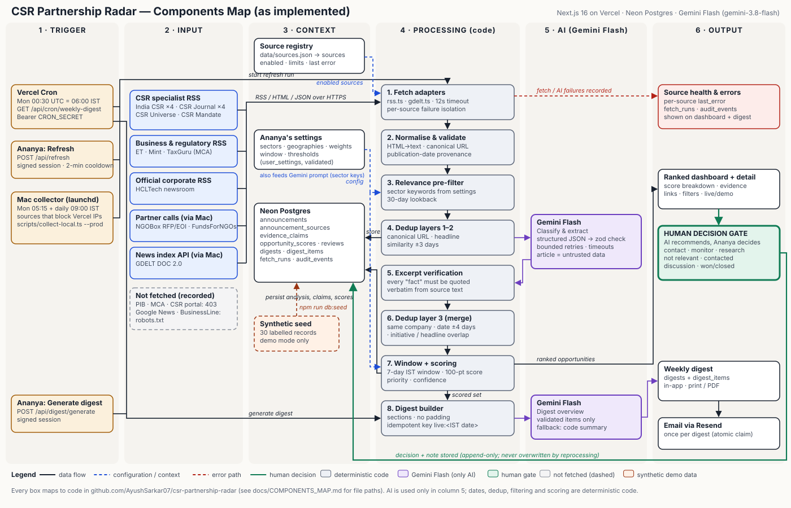
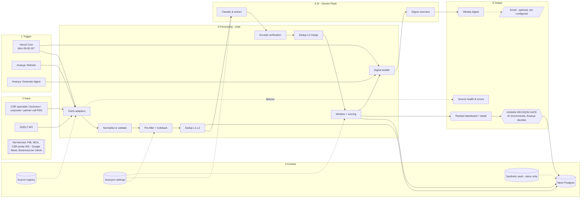

# Components Map

**Diagram:** [`components-map.svg`](components-map.svg), also served at https://csr-partnership-radar-six.vercel.app/components-map.svg. It is generated by `python3 scripts/build-components-map.py`, so edit that script to change it. An editable Mermaid version follows below.

Structure: **Trigger → Input → Context → Processing → AI → Output**. Every node corresponds to code or data that exists in this repository and was exercised during verification. Nothing is drawn that is not implemented: email appears dashed because the code exists but no provider is configured.

## Actors and components → implementation
| Stage | Component | Actor / type | Implementation |
|---|---|---|---|
| Trigger | Vercel Cron, Mon 00:30 UTC (06:00 IST) | Platform scheduler | `vercel.json`, `src/app/api/cron/weekly-digest/route.ts` (Bearer `CRON_SECRET`) |
| Trigger | Refresh intelligence | **Ananya** | `src/components/ActionButtons.tsx` → `src/app/api/refresh/route.ts` |
| Trigger | Generate digest now | **Ananya** | `ActionButtons.tsx` → `src/app/api/digest/generate/route.ts` |
| Input | CSR specialist RSS (India CSR ×4, CSR Journal ×4) | External sources | `data/sources.json`, `src/lib/sources/adapters/rss.ts` |
| Input | Business news RSS (ET, Mint) | External sources | same |
| Input | Official corporate RSS (HCLTech) | External source | same |
| Input | Partner-call RSS (FundsForNGOs) | External source | same (+ India-mention filter) |
| Input | GDELT DOC 2.0 API | External API | `src/lib/sources/adapters/gdelt.ts` |
| Input (not fetched) | PIB, MCA, CSR portal (403), Google News, BusinessLine (robots.txt) | Recorded limitation | registry entries, disabled or `link_only` |
| Context | Source registry | Config + DB | `data/sources.json` → `sources` table (`src/lib/sources/registry.ts`) |
| Context | Ananya's settings | Config (DB) | `user_settings`, `src/lib/settings/*`, `/settings` |
| Context | Stored records | Neon Postgres | `db/migrations/001_initial.sql` |
| Context | Synthetic seed data (demo only) | Fixture | `data/seed-opportunities.json`, `src/lib/seed.ts` |
| Processing | 1 Fetch adapters | Code | `src/lib/sources/http.ts`, `runRefresh()` in `src/lib/pipeline/ingest.ts` |
| Processing | 2 Normalise & validate | Code | `normalizeItem()` in `src/lib/pipeline/normalize.ts`, `src/lib/text.ts` |
| Processing | 3 Relevance pre-filter + lookback | Code | `prefilter()`, `ingestItems()` |
| Processing | 4 Dedup L1–L2 | Code | `ingestItems()`, `findCluster()` |
| AI | Classify & extract | **Gemini Flash** | `src/lib/ai/gemini.ts`, `src/lib/ai/classify.ts`, `src/lib/ai/analysis.ts` |
| Processing | 5 Excerpt verification | Code | `verifyClaims()`, `containsExcerpt()` |
| Processing | 6 Dedup L3 merge | Code | `mergeDuplicates()` |
| Processing | 7 Window + scoring | Code | `src/lib/time/window.ts`, `src/lib/scoring/score.ts`, `src/lib/repo/opportunities.ts` |
| Processing | 8 Digest builder | Code | `src/lib/digest/build.ts`, `generateDigest()` |
| AI | Digest overview | **Gemini Flash** | `geminiSummarizer` in `src/lib/digest/generate.ts` (code fallback `fallbackSummary`) |
| Output | Ranked dashboard + detail | UI | `src/app/page.tsx`, `src/app/opportunities/[id]/page.tsx` |
| Output | **Human decision gate** | **Ananya decides** | `src/components/ReviewControl.tsx` → `PATCH /api/opportunities/[id]` → `opportunity_reviews` (append-only) |
| Output | Weekly digest | DB + UI | `digests`, `digest_items`, `src/app/digest/*`, `DigestView.tsx` |
| Output | Email (optional) | Resend | `src/lib/delivery/email.ts`. Not configured, so the status reads `not_configured` |
| Output / error path | Source health & failures | DB + UI | `sources.last_error`, `fetch_runs`, `audit_events`, `SourceHealth.tsx`, digest "failed sources" section |

## Key handoffs
1. **Trigger → Processing:** cron or manual refresh starts `runRefresh()`. Scheduled runs carry a `run_key` (`weekly:<IST date>`), so they execute once.
2. **Input → Processing:** adapters return `RawItem`s; nothing from the network is trusted, rendered or followed.
3. **Processing → AI:** only items that pass deterministic validation, pre-filter and dedup are sent to Gemini, with the article text wrapped as untrusted data. Output must pass the zod schema.
4. **AI → Processing:** every "fact" excerpt is verified against the retrieved text before scoring. AI never sets dates, URLs or scores.
5. **Processing → Output:** scores are computed in code with the current settings and window. Synthetic and live records never mix (`data_origin`).
6. **Output → Human gate → DB:** Ananya's decision and note are stored append-only and reused by the digest ("not relevant" and "won/closed" are excluded).
7. **Error path:** fetch failures go to `sources.last_error` and `fetch_runs.details`, and appear on the dashboard and in the digest. AI failures go to `announcements.ai_status/ai_error` (retried up to 3 times); a digest AI failure triggers the code summary, recorded as `summary_source`.

## Where AI is used, and where it isn't
| Uses Gemini Flash | Deterministic code |
|---|---|
| Sector classification, entity extraction (company, initiative, geographies, beneficiaries), announcement type, partner and funding signals, summary, why it matters, evidence claims, missing info, next action, outreach angle, policy implication | Fetching, parsing, dates and the reporting window, canonical URLs, pre-filtering, all deduplication, excerpt verification, scoring, priority, confidence, digest sectioning, idempotency, delivery, access control |
| Weekly digest overview (from validated items only) | Fallback summary |

## Mermaid (editable)

